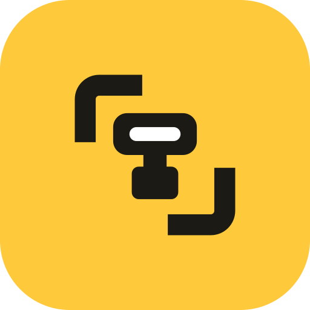

<div align="center">
  # Jackpix · Frameduel · Lensjet · Blitzlens

  **Four native apps to cull, compare and organize your photos at speed — one each for Android phones, Android tablets & DeX, the Mac and GNOME. Private and offline.**

  [](LICENSE)
  [](https://kotlinlang.org/)
  [](https://swift.org/)
  [](https://www.python.org/)
  [](https://github.com/alexpp90/photo-selector/actions/workflows/android.yml)
  [](https://github.com/alexpp90/photo-selector/actions/workflows/macos.yml)
  [](https://github.com/alexpp90/photo-selector/actions/workflows/linux.yml)
  [](docs/build/RELEASING.md)
  [](#-android-installation)
  [](#-macos-desktop-installation)
  [](#-linux-desktop-installation)

  <br />
  
</div>

---

## 🌟 The Apps at a Glance

**Jackpix**, **Frameduel**, **Lensjet** and **Blitzlens** are privacy-first, high-velocity photo culling and metadata analysis apps for professional photographers, enthusiasts, and creators. Whether sorting on the go on your phone, reviewing burst sequences on a tablet, or performing intensive multi-thousand RAW triage at your desktop workstation, each app is built natively for its platform. The original multi-platform Python app, **Photo Selector Toolbox (Legacy)**, stays here as an archived reference.

> 🔒 **100% Private & Strictly Offline:** Your photos never leave your device. All EXIF parsing, duplicate detection, and optical/aesthetic quality scoring (including Apple Vision on the Neural Engine) execute strictly on-device. Zero cloud uploads, zero telemetry, and no account required.

---

## 📦 Five Products, One Shared Repository

The repository ships **five products** (four active native solutions alongside the archived legacy Desktop), each optimized for its environment and UX model. They share photographic *concepts* — the EXIF contract, score semantics, what "Selection" means — and, between the two Android products, one shared core library. They do not share implementations.

| Product | Directory | Tech Stack | Target Environment | Primary UX Paradigm | Docs |
| :--- | :--- | :--- | :--- | :--- | :--- |
| 📱 **Jackpix** | `products/android/phototok/` | Kotlin, Compose, DataStore | Portrait phones ($< 600$dp) | Gesture-first vertical swipe feed | [docs](docs/products/phototok/README.md) |
| 🖥️ **Frameduel** (Android Desktop) | `products/android/android-desktop/` | Kotlin, Compose, Room, OpenCV | Samsung DeX, tablets ($\ge 840$dp) | 1-over-2 three-frame layout, sidebar & controls | [docs](docs/products/android-desktop/README.md) |
| 🍎 **Lensjet** (macOS Desktop) | `products/macos-desktop/` | Swift 6, SwiftUI, Vision, Accelerate | macOS 14+ / 15+ Apple Silicon & Intel | Maximized preview (>85%), Apple Vision aesthetics | [docs](docs/products/macos-desktop/README.md) |
| 🐧 **Blitzlens** (Linux Desktop) | `products/linux-desktop/` | Python 3.12+, GTK4, Libadwaita | Debian 13 (Trixie), GNOME 46+ | Libadwaita dark studio, 1/2/3-Up canvas, NumPy (<2ms) | [docs](docs/products/linux-desktop/README.md) |
| 📦 **Photo Selector Toolbox (Legacy)** | `products/desktop/src/` | Python 3.10+, Tkinter | macOS, Windows, Linux | Split view, menu/hotkeys (archived reference) | [docs](docs/products/desktop/README.md) |
| *(shared library)* | `products/android/core/` | Kotlin | — | EXIF model + readers used by both Android products | [docs](docs/shared/README.md) |
| *(shared library)* | `products/android/saf/` | Kotlin | — | SAF copy/move engine + folder grants used by both Android products | [docs](docs/shared/README.md) |

Naming matters here — "the Android app" is ambiguous. Canonical names, slugs, and package mappings are defined in [`docs/GLOSSARY.md`](docs/GLOSSARY.md); names, icons and colours in [`docs/shared/BRANDING.md`](docs/shared/BRANDING.md).

### Repository Map

All product code lives under `products/`, one directory per product, sharing the same shape:
`src/` for sources, `tests/` for tests, its own build configuration, and its own `README.md`.
Everything else at the repository root is genuinely cross-product.

```
products/
  android/                   Gradle build root for both Android products
    phototok/                  Jackpix (Phone)        — src/ tests/ res/ AndroidManifest.xml
    android-desktop/           Frameduel (DeX)        — src/ tests/ res/ AndroidManifest.xml
    core/                      :core — EXIF model + readers, shared by both Android products
    saf/                       :saf — SAF file operations, shared by both Android products
  macos-desktop/             Lensjet (macOS)        — src/ tests/ Package.swift
  linux-desktop/             Blitzlens (GNOME)      — src/ tests/ debian/ scripts/ pyproject.toml
  desktop/                   Archived Legacy Desktop— src/ tests/ benchmarks/ scripts/ pyproject.toml
docs/                        Product documentation, per product -> docs/README.md
scripts/                     Cross-product tooling — run_tests.sh (local CI mirror)
assets/                      Screenshots, banner; brand/ holds icon masters, palette and generator
```

---

## 📱 1. Jackpix (Phone)

A lightweight, touch-optimized portrait client designed for lightning-fast, single-handed photo curation on your phone.

<div align="center">
  
  <p><em>Vertical gesture culling with a glassmorphic EXIF HUD, responsive swipe feedback, and coach marks</em></p>
</div>

### Key Features
* **Full-Screen Vertical Swipe Feed:** Browse local collections seamlessly via Jetpack Compose native `VerticalPager` with background prefetching and progressive SAF loading (sub-second time-to-first-swipe).
* **Tactile Culling Swipes:**
  * **Swipe-Right to File:** Instantly copy or move photos to your designated `Selection/` folder with an animated green confirmation glow.
  * **Swipe-Left to Discard or Route:** Configurable action (Trash/Delete, Copy, or Move to secondary folder) with progressive card tilt ($2^\circ$) and non-blocking **Revert** (`RestoreFromTrash`) across scrolls.
* **Session Resume & New Photos Prompt:** Reopening a folder resumes where you left off. Only when newer photos exist does a short "N new photos" dialog offer **Show new** or **Stay**.
* **Fluid Zoom & Pan:** Pinch-to-zoom (up to $6\times$) and double-tap to 2.5x zoom with single-finger panning; gestures automatically disable paging conflicts while zoomed.
* **One-Tap Glassmorphic HUD:** Single tap toggles the translucent camera metadata panel (shutter, aperture, ISO, focal length, lens) and icon-only navigation controls (long-press for the name) for unobstructed viewing.
* **In-Place Guidance & Pairing:** Interactive coach-mark overlay anchored directly to UI controls, automatic companion pairing (a linked move or delete takes the RAW+JPEG twin, `-Edit` / `-Enhanced-NR` derivatives and `.xmp` sidecars along), and orientation-aware feed ordering.

---

## 🖥️ 2. Frameduel — Android Desktop (Tablet & Samsung DeX)

Built specifically for large-screen tablets (≥ 840 dp) and desktop environments like Samsung DeX, providing a complete studio workstation on Android.

<div align="center">
  
  <p><em>Galaxy Tab S11 Ultra 1-over-2 layout: Current frame centered with optical readouts and controls; Previous/Next below</em></p>
</div>

### Key Features
* **1-over-2 Three-Frame Layout:** Height-optimized comparison architecture allocating maximum display area to the Current frame, flanked by named metric readouts to the left and primary action buttons to the right, with Previous and Next frames centered as a pair beneath.
* **Zero-Area-Cost Columnar Chrome:** 88dp labeled left sidebar and 72dp vertical filmstrip running top-to-bottom in horizontal display slack, preserving 100% of vertical photo height without adding top or bottom bars.
* **On-Device Optical Scoring:** Real-time Center Sharpness (OpenCV Laplacian variance on center 50% ROI), MAD noise floor estimation, highlight/shadow clipping histograms.
* **Star Ratings & Composition Feedback:** 1–5 star rating controls, reject tags, and composition heuristics persisted in a local Room SQLite database with a 10,000-image MRU cache.
* **Desktop Ergonomics:** Mouse pointer hover states (`PointerIcon.Hand`), physical keyboard shortcuts (`←`/`→`, `M`, `C`, `Del`, `1`/`2`/`3`, `Esc`), and drag-and-drop folder import from Android file managers. Every control is a ≥ 48 dp touch target, and in small Chromebook or DeX windows the action buttons restack their word and key cap instead of truncating them.
* **Every Camera Format:** Discovers, displays, reads EXIF from and scores Sony, Canon (incl. CR3), Nikon, Fujifilm, Panasonic, OM System, Pentax, Samsung and DNG RAW files plus JPEG, HEIC, PNG, TIFF and WebP. RAWs are shown from their embedded camera JPEG; phone DNGs fall back to the platform decoder. Proven against real camera files ([supported formats](docs/shared/SUPPORTED_FORMATS.md)).
* **Zero Network Permissions:** Declares no Android permissions (`INTERNET` included) and requires zero Google Play Services dependencies for complete privacy.

---

## 🍎 3. Lensjet — Native macOS Desktop (Swift & SwiftUI)

A high-performance native macOS photo selection and comparison culling suite built with Swift 6 and SwiftUI, engineered for high-throughput SD-card ingestion and instant triage.

<div align="center">
  
  <p><em>Native macOS studio workspace with floating Apple Vision HUD pill, 1-Up maximized canvas, and tactile action bar</em></p>
</div>

### Key Features
* **Pure Native Apple Vision Aesthetics:** On-device aesthetic scoring via `VNCalculateImageAestheticsScoresRequest` utilizing Apple Neural Engine hardware with zero Python or external network dependencies.
* **Hardware-Accelerated Focus Metric:** Sub-millisecond 2D Laplacian variance computation via Apple Accelerate (`vImageConvolve_PlanarF` + `vDSP`), processing >1,500 images/second per thread with noise-floor subtraction.
* **Maximized Viewport Canvas:** Borderless comparison layouts (1-Up with 1:1 pixel zoom on `Space`, 2-Up side-by-side, and Focus 3-Up sliding triplet) allocating >85% of window area to photo previews.
* **Zero-Latency Keyboard Navigation:** Window-level `NSEvent` interceptor routing arrow keys, `M` (Move to `Selection/`), `C` (Copy), `Delete` (System Trash), and `⌘Z` (Instant Undo) with zero AppKit focus lag.
* **Actor-Isolated Transactional Culling:** Serial FIFO disk mutations on `AsyncCullingActor` guaranteeing zero data loss and automated companion file pairing (RAW+JPEG, XMP sidecars).
* **macOS Design Standards:** Studio dark theme, configuration housed in standard macOS Settings (`⌘,`), secondary utilities housed under the Menu Bar `Tools` menu, and a toolbar and action bar that collapse to short labels and icons (with tooltips) in narrow windows instead of wrapping.

---

## 🐧 4. Blitzlens — Linux Desktop (GNOME 46+ & Libadwaita)

A native GNOME photograph culling and selection suite targeting Debian 13 (Trixie) and modern Linux desktop environments adhering strictly to GNOME Human Interface Guidelines (HIG).

<div align="center">
  
  <br />
  
  <p><em>Native GNOME 46 / Libadwaita workspace on neutral grey surfaces with segmented comparison controls, glassmorphic optical HUD with sharpness goodness bar, and semantic bottom action bar</em></p>
</div>

### Key Features
* **Neutral Dark Workspace:** Built with Python 3.12+, PyGObject, GTK4, and Libadwaita on colour-neutral grey surfaces (`#141414` / `#181818` / `#1C1C1C`); selection and focus follow the GNOME accent setting, and the fixed keeper / acceptable / cull colours carry only their meaning.
* **Vectorized NumPy Focus Engine & Goodness HUD:** 2D discrete Laplacian convolution with 3x3 Gaussian smoothing and strided Median Absolute Deviation (MAD) noise floor subtraction (<2.0 ms compute latency), paired with a glassmorphic HUD (`I`) displaying a normalized sharpness goodness meter, semantic quality badges (`Sharp` / `Acceptable` / `Blurry`), and `RAW+JPG` / `XMP` companion pills.
* **Responsive Canvas Viewports:** Seamlessly switch between 1-Up (1:1 actual-pixel zoom toggle on `Space`), 2-Up side-by-side comparison (`CHAMPION` / `CHALLENGER`), and 3-Up Focus Mode (one-over-two: `ACTIVE` on top, `PREVIOUS` / `NEXT` below) with boundary slot indicators. Move, Copy, Trash and Undo outcomes show in the bottom action bar, never over its buttons.
* **Every Camera Format & Google Drive:** Displays, reads EXIF from and scores Sony, Canon (incl. CR3), Nikon, Fujifilm, Panasonic, OM System, Pentax, Samsung and DNG RAW files plus JPEG, HEIC, PNG, TIFF and WebP, proven against real camera files ([supported formats](docs/shared/SUPPORTED_FORMATS.md)). RAWs display through their embedded camera preview (phone DNGs through LibRaw), decoded in the background; folders on Google Drive (GNOME Online Accounts) open like local folders with their real file names, and Move, Copy, Trash and Undo work there too (trashed Drive files go to the local GNOME Trash, so Undo can bring them back). File operations run in the background, so the window stays responsive during a Drive upload, and 1:1 zoom on a RAW shows full sensor resolution.
* **Semantic Action Bar:** Bottom `Gtk.ActionBar` with semantic status counter pills (`Selected`, `Trashed`, `Remaining`), tactile `Move (M)`, `Copy (C)`, `Trash (Del)` via FreeDesktop Trash (`Gio.File.trash()`), and atomic reversal (`Ctrl+Z`).
* **Debian 13 APT Distribution:** Packaged as a native Debian `.deb` with GNOME HIG squircle SVG/PNG icons and AppStream branding, in a signed APT repository ([alexpp90/apt](https://github.com/alexpp90/apt)) for seamless updates.

---

## 📦 5. Photo Selector Toolbox — Archived Legacy Desktop (Python & Tkinter)

The original multi-platform desktop culling application built with Python and Tkinter, preserved as an archived reference implementation.

<div align="center">
  
  <p><em>The original zinc-themed Python/Tkinter Desktop workspace</em></p>
</div>

### Key Features
* **Dynamic Review Layouts:** Toggle between Standard split view and Focus mode.
* **Optical & VLM Algorithms:** Laplacian variance sharpness, MAD noise calculation, highlight/shadow clipping, and optional offline local Ollama vision model scoring.
* **Library Utilities:** Matplotlib EXIF histograms, dHash burst grouping, and SHA-256 duplicate detection.

---

## 📊 Platform Feature Sync Matrix

| Feature | Jackpix (Phone) | Frameduel (Tablet/DeX) | Lensjet (macOS) | Blitzlens (GTK4/Adw) | Legacy Desktop (Py/Tk) | Notes |
| :--- | :---: | :---: | :---: | :---: | :---: | :--- |
| **Review Layouts** | Vertical Pager | 1-over-2 Three-Frame | 1-Up / 2-Up / 3-Up | 1-Up / 2-Up / 3-Up | Standard / Focus | Jackpix is gesture-first; the desktop apps provide multi-frame comparison. |
| **Center Sharpness Score** | ❌ Omitted | ✅ (OpenCV) | ✅ (vImage + vDSP) | ✅ (NumPy Laplacian) | ✅ (OpenCV/NumPy) | 50% ROI Laplacian variance; omitted on Jackpix for sub-second launch. |
| **Laplacian Noise (MAD)** | ❌ Omitted | ✅ (MAD) | ✅ (vImage MAD) | ✅ (NumPy MAD) | ✅ (MAD) | Median Absolute Deviation sensor noise floor subtraction. |
| **Highlights/Shadows Clipping** | ❌ Omitted | ✅ (Histograms) | ✅ (vImage Hist) | ✅ (NumPy Hist) | ✅ (Histograms) | Hardware histogram thresholds $\ge 254$ and $\le 2$. |
| **Aesthetic Scoring** | ❌ Excluded | ❌ Excluded | ✅ (Apple Vision ANE) | ❌ Excluded | ✅ (Local Ollama) | Lensjet uses the Apple Neural Engine; Frameduel scores technical quality only. |
| **Star Ratings (1–5)** | ❌ Omitted | ✅ (Room) | ❌ Omitted | ❌ Omitted | ❌ Omitted | Rating, reject, and composition tracking in Room DB. |
| **Score Caching** | ❌ Lightweight | ✅ (Room DB) | ❌ (Memory LRU) | ❌ (Memory LRU) | ✅ (SQLite) | Desktops rely on sub-2ms compute & memory LRU; Android uses Room. |
| **Duplicate Detection** | ❌ Omitted | ✅ (Room DB) | ✅ (CryptoKit SHA) | ✅ (Streaming SHA) | ✅ (SHA-256) | Two-stage size pre-filtering and SHA-256 duplicate finder. |
| **Tactile Keyboard Shortcuts** | ❌ Touch-first | ✅ (DeX / Physical) | ✅ (Zero-latency NSEvent)| ✅ (GTK Capture) | ✅ (Tkinter Events) | Full hotkey routing (`←`/`→`, `M`, `C`, `Del`, `Undo`). |
| **100% Offline Privacy** | ✅ (SAF Only) | ✅ (Zero Permissions) | ✅ (Strictly Local) | ✅ (Strictly Local) | ✅ (Local) | Zero telemetry, zero cloud dependencies, strict privacy guarantee. |

---

## 🚀 Installation

### 📱 Android Installation (Jackpix & Frameduel)

#### Option A: Obtainium (Direct Auto-Updates)
1. Install [Obtainium](https://github.com/ImranOmarRashid/Obtainium) on your Android device.
2. In Obtainium, click **Add App** and paste this repository's URL: `https://github.com/alexpp90/photo-selector`.
3. Each app has its own releases, named `Jackpix X.Y.Z` and `Frameduel X.Y.Z`: set Obtainium's **Filter release titles by regular expression** to `^Jackpix ` or `^Frameduel ` (or allow pre-releases for the `nightly` build). Obtainium will download and install APK updates directly from GitHub Releases.

#### Option B: GitHub Releases (Direct APK)
Download the APK from the latest [Jackpix](https://github.com/alexpp90/photo-selector/releases?q=phototok-v&expanded=true) or [Frameduel](https://github.com/alexpp90/photo-selector/releases?q=android-desktop-v&expanded=true) release.

---

### 🍎 Lensjet (macOS) Installation

#### Homebrew Cask
Install Lensjet via the Homebrew tap:

```bash
# Install directly in a single command
brew install --cask alexpp90/tap/photo-selector-toolbox

# Or tap first, then install:
brew tap alexpp90/tap
brew install --cask photo-selector-toolbox
```

#### Standalone ZIP
Download the pre-compiled `photo-selector-macos-apple-silicon.zip` from the latest [Lensjet release](https://github.com/alexpp90/photo-selector/releases?q=macos-desktop-v&expanded=true), unpack it, and drag `Lensjet.app` into `/Applications`.

---

### 🐧 Blitzlens (Linux) Installation (Debian 13 Trixie)

One line (adds the signed APT repository, then installs; the Debian package keeps its name `photo-selector-linux`):

```bash
curl -fsSL https://alexpp90.github.io/apt/setup.sh | sudo bash
sudo apt install photo-selector-linux
```

Or add the repository keyring and deb822 source by hand:

```bash
# 1. Install repository keyring
sudo mkdir -p /etc/apt/keyrings
curl -fsSL https://alexpp90.github.io/apt/photo-selector-archive-keyring.gpg | sudo tee /etc/apt/keyrings/photo-selector-archive-keyring.gpg > /dev/null

# 2. Add repository source
sudo tee /etc/apt/sources.list.d/photo-selector.sources << EOF
Types: deb
URIs: https://alexpp90.github.io/apt
Suites: trixie
Components: main
Signed-By: /etc/apt/keyrings/photo-selector-archive-keyring.gpg
EOF

# 3. Update and install
sudo apt update
sudo apt install photo-selector-linux
```

---

### 💻 Archived Legacy Desktop Installation

For Windows or systems running the legacy Python/Tkinter application (or running both native macOS and legacy Python side-by-side):

#### macOS Homebrew Cask (Legacy Python Desktop)
Install the legacy Python/Tkinter application into `/Applications` alongside the native app:
```bash
brew install --cask alexpp90/tap/photo-selector-toolbox-legacy
```

#### macOS / Linux CLI via Homebrew Formula
```bash
brew install alexpp90/tap/photo-selector-toolbox
```

Standalone archives are available on [GitHub Releases](https://github.com/alexpp90/photo-selector/releases):
* **macOS Apple Silicon:** `photo-selector-toolbox-macos-apple-silicon.zip`
* **Windows x64:** `photo-selector-toolbox-windows-x64.zip`
* **Linux x64:** `photo-selector-toolbox-linux-x64.zip`

---

## 🛠️ Run from Source

### 📱 Android Setup (Jackpix & Frameduel)
1. Open the repository root in **Android Studio Ladybug** (or newer).
2. Ensure JDK 17 and Android SDK 36 are configured.
3. Build the debug binaries:
   ```bash
   cd products/android
   ./gradlew assembleDebug
   ```
   Debug APKs are output to:
   - Jackpix: `products/android/phototok/build/outputs/apk/debug/`
   - Frameduel: `products/android/android-desktop/build/outputs/apk/debug/`

### 🍎 Lensjet Setup (Swift 6)
1. Ensure Xcode 16+ or Command Line Tools with Swift 6 are installed.
2. Build and run from `products/macos-desktop`:
   ```bash
   cd products/macos-desktop
   swift build
   swift run PhotoSelectorApp
   ```

### 🐧 Blitzlens Setup (Python & GTK4)
1. Ensure Python 3.12+ and system GTK4 / Libadwaita libraries are installed:
   ```bash
   sudo apt install python3-gi python3-gi-cairo gir1.2-gtk-4.0 gir1.2-adw-1 libgexiv2-2
   ```
2. Run directly from `products/linux-desktop`:
   ```bash
   cd products/linux-desktop
   PYTHONPATH=src python3 -m photo_selector_linux [path/to/photos]
   ```

### 💻 Legacy Desktop Setup (Python 3.10+)
1. Ensure Python 3.10+ and Tkinter are installed:
   ```bash
   cd products/desktop
   poetry install
   poetry run photo-selector-gui
   ```

---

## 🧪 Testing

### The CI Parity Mirror
To verify all products against the exact gates CI enforces:
```bash
./scripts/run_tests.sh          # Auto-detects modified products
./scripts/run_tests.sh --all    # Verifies all products unconditionally
```

### Individual Product Test Suites
* **Android (JVM Unit & Instrumented):**
  ```bash
  cd products/android
  ./gradlew testDebugUnitTest
  ./gradlew connectedDebugAndroidTest
  ```
* **Lensjet (Swift 6):**
  ```bash
  cd products/macos-desktop
  swift test
  ```
* **Blitzlens (Pytest):**
  ```bash
  cd products/linux-desktop
  pytest tests/unit/
  ```
* **Legacy Desktop (Pytest):**
  ```bash
  cd products/desktop
  poetry run pytest
  ```

---

## 📄 License
The source code is open source under the [MIT License](LICENSE).
The app names **Jackpix**, **Frameduel**, **Lensjet**, **Blitzlens** and **Photo Selector Toolbox** and the logos are not covered by that license — see [TRADEMARKS.md](TRADEMARKS.md) before distributing a modified build.
Contributions are accepted under the [Contributor License Agreement](CLA.md), signed once with a PR comment.
Third-party notices and licenses are detailed in [THIRDPARTY_NOTICES.txt](THIRDPARTY_NOTICES.txt).
