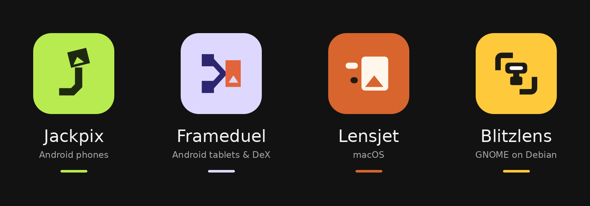
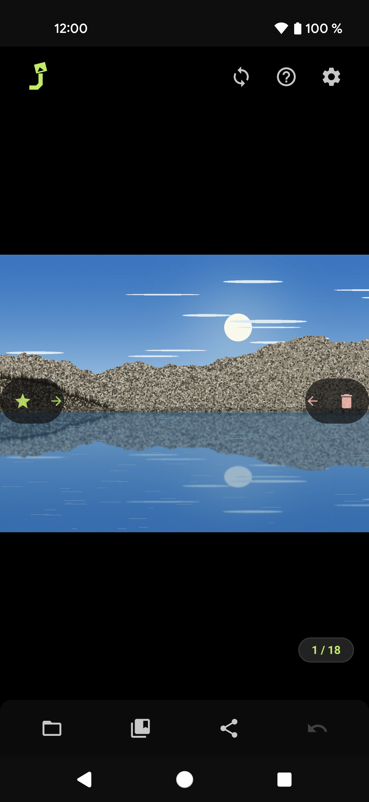
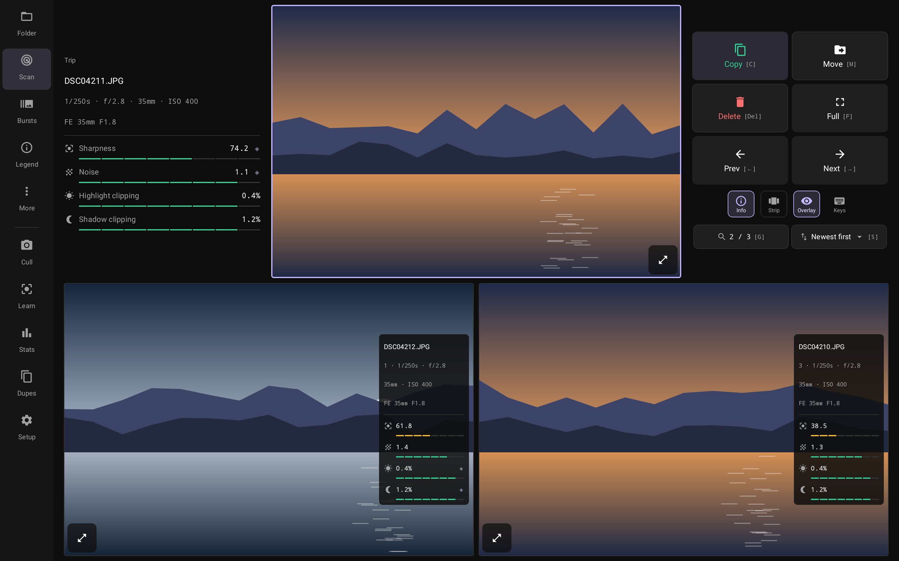
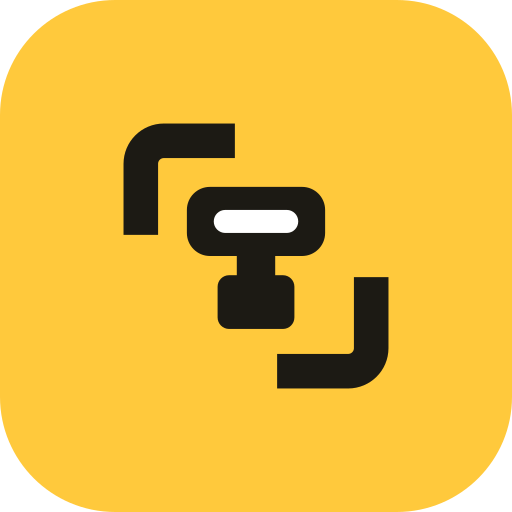
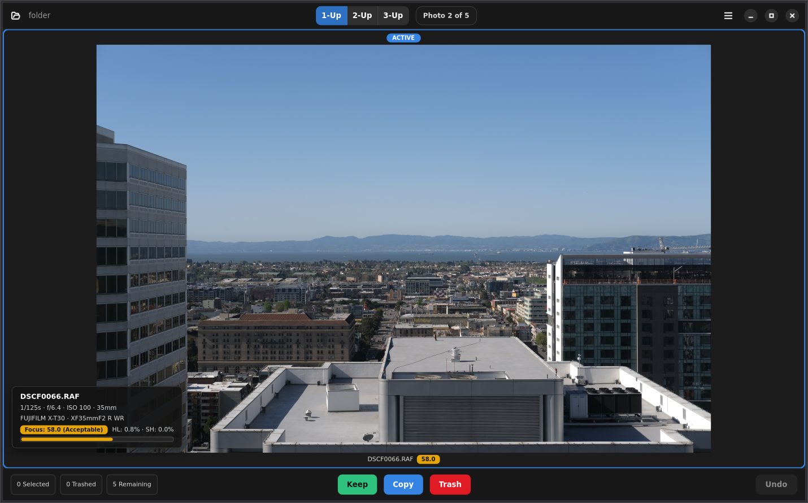

<div align="center">

  # Jackpix · Frameduel · Lensjet · Blitzlens

  **Four native apps to cull, compare and organize your photos at speed — one each for Android phones, Android tablets & DeX, the Mac and GNOME. Private and offline.**

  [](LICENSE)
  [](https://kotlinlang.org/)
  [](https://swift.org/)
  [](https://www.python.org/)
  [](https://github.com/alexpp90/photo-selector/actions/workflows/android.yml)
  [](https://github.com/alexpp90/photo-selector/actions/workflows/macos.yml)
  [](https://github.com/alexpp90/photo-selector/actions/workflows/linux.yml)
  [](docs/build/RELEASING.md)
  [](#-android-installation-jackpix--frameduel)
  [](#-lensjet-macos-installation)
  [](#-blitzlens-linux-installation-debian-13-trixie)

  <br />
  
</div>

---

## 🌟 The Apps at a Glance

**Jackpix**, **Frameduel**, **Lensjet** and **Blitzlens** are photo culling apps for photographers: go through a shoot, keep the frames worth keeping in a Selection folder, and delete the rest. Jackpix is for swiping through photos on the phone, Frameduel compares neighbouring frames on a tablet, in Samsung DeX or on a Chromebook, and Lensjet and Blitzlens triage large RAW folders on the Mac and on GNOME. Each app is built natively for its platform. The original multi-platform Python app, **Photo Selector Toolbox (Legacy)**, stays here as an archived reference.

> 🔒 **Private and offline:** Jackpix, Frameduel, Lensjet and Blitzlens open no network connection of their own: no account, no telemetry, no upload. EXIF reading, duplicate detection and quality scoring (Lensjet's Apple Vision score included) run on your device. A folder you open on a cloud drive stays there; the apps reach it through the system's own file access. The one exception is the archived legacy Desktop: its optional Ollama scoring sends images to the Ollama server you configure (localhost by default).

---

## 📦 Five Products, One Shared Repository

The repository ships **five products** (four active native solutions alongside the archived legacy Desktop), each optimized for its environment and UX model. They share photographic *concepts* — the EXIF contract, score semantics, what "Selection" means — and, between the two Android products, one shared core library. They do not share implementations.

| Product | Directory | Tech Stack | Target Environment | Primary UX Paradigm | Docs |
| :--- | :--- | :--- | :--- | :--- | :--- |
| 📱 **Jackpix** | `products/android/phototok/` | Kotlin, Compose, DataStore | Phones of every size | Gesture-first vertical swipe feed | [docs](docs/products/phototok/README.md) |
| 🖥️ **Frameduel** (Android Desktop) | `products/android/android-desktop/` | Kotlin, Compose, Room, OpenCV | Samsung DeX, tablets ($\ge 840$dp) | 1-over-2 three-frame layout, sidebar & controls | [docs](docs/products/android-desktop/README.md) |
| 🍎 **Lensjet** (macOS Desktop) | `products/macos-desktop/` | Swift 6, SwiftUI, Vision, Accelerate | macOS 14+ / 15+ Apple Silicon & Intel | Maximized preview (>85%), Apple Vision aesthetics | [docs](docs/products/macos-desktop/README.md) |
| 🐧 **Blitzlens** (Linux Desktop) | `products/linux-desktop/` | Python 3.12+, GTK4, Libadwaita | Debian 13 (Trixie), GNOME 46+ | Libadwaita dark studio, 1/2/3-Up canvas, NumPy scoring | [docs](docs/products/linux-desktop/README.md) |
| 📦 **Photo Selector Toolbox (Legacy)** | `products/desktop/src/` | Python 3.12+, Tkinter | macOS, Windows, Linux | Split view, menu/hotkeys (archived reference) | [docs](docs/products/desktop/README.md) |
| *(shared library)* | `products/android/core/` | Kotlin | — | EXIF model + readers used by both Android products | [docs](docs/shared/README.md) |
| *(shared library)* | `products/android/saf/` | Kotlin | — | SAF copy/move engine + folder grants used by both Android products | [docs](docs/shared/README.md) |

Naming matters here — "the Android app" is ambiguous. Canonical names, slugs, and package mappings are defined in [`docs/GLOSSARY.md`](docs/GLOSSARY.md); names, icons and colours in [`docs/shared/BRANDING.md`](docs/shared/BRANDING.md).

---

## 📱 1. Jackpix (Phone)

A touch-first portrait app for sorting your photos one-handed on the phone.

<div align="center">
  
  <p><em>Vertical gesture culling with a glassmorphic EXIF HUD, responsive swipe feedback, and coach marks</em></p>
</div>

### Key Features
* **Casual or Pro, One Switch:** Out of the box Jackpix is set up for fast swiping with nothing to configure — ★ favourites on the phone, SD-card keepers copied into the phone's camera folder (`DCIM/Camera/Jackpix`), RAW + JPEG kept together, no camera info. The **Pro mode** switch on the start screen (and at the top of Settings) turns on camera info and unlocks swipe actions, folders, feed order, format filters and per-source profiles; switching it off pauses those settings without erasing them. Settings survive app updates.
* **See What Swipe Right Does, and What You Did:** Each source on the start screen (Phone photos, SD card / USB, Folder or cloud) shows a small glyph for its swipe right (★, copy to the phone, or a folder); the start screen shows your totals and, back from a folder, that session's photos reviewed, kept and space freed; the "Done with this card" sheet counts the photos copied off the card. Jackpix shows photos, not videos.
* **Full-Screen Vertical Swipe Feed:** Browse local collections seamlessly via Jetpack Compose native `VerticalPager` with background prefetching and progressive loading: you can swipe once the first 24 photos are found, while the rest of the folder is still being read.
* **Tactile Culling Swipes:**
  * **Swipe-Right to Keep:** Mark a ★ favourite, or (Pro) copy or move the photo to your `Selection/` folder, with an animated lime confirmation glow.
  * **Swipe-Left to Discard or Route:** Configurable action (Delete after confirmation — phone photos go to Android's Trash on Android 11+ after one system prompt when you leave the folder, SD card, USB and cloud files are deleted permanently — Copy, or Move to a secondary folder) with progressive card tilt ($2^\circ$) and non-blocking **Undo** (a "Photo deleted · Undo" snackbar and the bar's `Undo` arrow) across scrolls.
* **Newest Photo First, Preloaded Ahead:** Phone, cloud, SD card and camera folders all start with the newest photo as `1/N`; Pro mode can sort by file name, shuffle or orientation instead, and in Casual a **surprise me** icon deals a phone or cloud folder once with the unseen photos first. Photos ahead of you in the direction you scroll are preloaded.
* **Session Resume, Reload & New Photos Prompt:** Reopening a folder resumes where you left off; only when newer photos exist does a short "N new photos" dialog offer **Show new** or **Stay**. The **Reload** button rescans the folder and jumps to its latest photo (position 1 in newest-first order), no dialog.
* **Share & Selection Viewer:** A **Share** button in the icon-only bottom bar shares the current photo while you scroll. The Selection button opens your Favourites and the Selection folder with photo counts, starting on the list your swipe right fills (the ★ chip on a photo opens Favourites); the two tabs appear only when both have photos.
* **Favourites in Other Apps:** On Android 11 and later a Jackpix favourite also sets Android's own favourite flag for photos on the phone and indexed SD cards (in batches, no permission and no dialog), and favourites set in other apps show in Jackpix; a filled star on the badge means the system has it too.
* **Fluid Zoom & Pan:** Pinch-to-zoom (up to $6\times$) and double-tap to 2.5x zoom with single-finger panning; gestures automatically disable paging conflicts while zoomed.
* **One-Tap Glassmorphic HUD:** Single tap toggles the translucent camera metadata panel (Pro mode: shutter, aperture, ISO, focal length, lens) and icon-only navigation controls (long-press for the name) for unobstructed viewing.
* **In-Place Guidance & Pairing:** Interactive coach-mark overlay anchored directly to UI controls, automatic companion pairing (a linked move or delete takes the RAW+JPEG twin, `-Edit` / `-Enhanced-NR` derivatives and `.xmp` sidecars along), and orientation-aware feed ordering.

---

## 🖥️ 2. Frameduel — Android Desktop (Tablet & Samsung DeX)

Built specifically for large-screen tablets (≥ 840 dp) and desktop environments like Samsung DeX, providing a complete studio workstation on Android.

<div align="center">
  
  <p><em>The cull view at the Galaxy Tab S11 Ultra's 1480 × 924 dp (2960 × 1848 px), rendered from the app's own screen code with procedural test landscapes: the current frame centred with its named values on the left and the worded action buttons, view toggles and Go / Sort chips on the right; Previous and Next below with their values on them</em></p>
</div>

### Key Features
* **1-over-2 Three-Frame Layout:** Three frames of the same size, so a comparison is fair: the current frame on top, its named readouts on the left and the action buttons on the right, and the previous and next frames side by side beneath it.
* **No Bars Above or Below the Photos:** An 88 dp labelled sidebar on the left and a 72 dp filmstrip column sit in the spare width, so the frames get the whole height of the window.
* **On-Device Quality Scores:** A Scan (from the sidebar) scores the folder's photos on the device: sharpness of the central half of the frame (OpenCV Laplacian variance), noise, and highlight and shadow clipping; untick a measurement in the scan sheet and it is not computed. Scores are kept in a local cache.
* **Tools beside the Cull:** The sidebar holds Cull, Stats, Tools and Setup; Tools opens Learn and the duplicate finder (Dupes).
* **Star Ratings & Composition Feedback (Learn):** 1–5 star rating controls, reject tags, a shoot debrief per kind of camera with a worked pair of two frames of one scene (guess first, then see what was measured), and composition heuristics persisted in a local Room SQLite database with a 10,000-image MRU cache. Ratings are written back to the photo too: embedded XMP for JPEG once you turn on **Write ratings into photos** (off on a new install; an install that already wrote ratings into JPEGs keeps it on; while it is rewritten, a `.frameduel-backup` copy of the original sits beside it, and an interrupted write is restored the next time the folder opens), an `.xmp` sidecar for RAW and TIFF; for other formats (PNG, HEIC, WebP) the rating stays in the app and you are told so.
* **Desktop Ergonomics:** Mouse pointer hover states (`PointerIcon.Hand`), physical keyboard shortcuts (`←`/`→` or `K`/`J`, `M`, `C`, `Del`, `1`/`2`/`3`, `Space` 100 % zoom on an enlarged frame and in fullscreen, `Shift`+arrows to pan, `G`, `S`, `T` filmstrip, `I` values, `L` Learn, `Esc`; the mouse wheel zooms in fullscreen; `I` pins the info panel in fullscreen; system Back closes the top layer like `Esc` and leaves the app only at the bare selector), and drag-and-drop folder import from Android file managers. Every control is a ≥ 48 dp touch target, and in small Chromebook or DeX windows or at the largest system font the action buttons restack their word and key cap — dropping the icon first and the key name last — instead of truncating the word.
* **Sort and Go To:** A folder opens newest first, and a folder you return to (after a restart too) opens at the photo you left it on. Right of the current photo, a Sort button (or `S`, or the overflow menu) switches to oldest first, file name or blurriest first (after a scan), and the choice is kept. The position counter beside it (or `G`) jumps straight to a photo by its number, a date (`12.10.2026`, `2026-10-12` or `12.10.`, or a calendar picker limited to days with photos; a day without photos goes to the nearest one) or its file name. In very small windows the two buttons give way to the counter, the keys and the overflow menu; below 600 dp a More button at the end of the action row opens the same menu (Open folder, Scan, Sort, Go to photo, Undo).
* **Where Photos Go:** Settings says where a move or copy lands: the Selection folder inside the folder you are culling (Working folder) or one you pick (Custom folder; with its own Selection folder open, into `Final` inside it, as in any Selection folder), with the full path shown, a warning when a custom folder lost its permission, and the folder named in the confirmation. Before a copy, or a move to another card or drive, it checks that the destination has room and refuses with the space it needs instead of failing halfway.
* **Edge-to-Edge Fullscreen:** One frame, full size (`1`/`2`/`3`) gives the photo the whole area beside the sidebar, with its details as an overlay that the ⓘ button on the frame turns off. In fullscreen (`F`) the photo fills the whole window. File name, position, exposure and lens float in a compact corner panel that fades after 3 s; `I` pins it. The lens is shown wherever the exposure is, in the comparison view too.
* **Quiet Feedback:** A move, copy or delete confirms with a short card that leaves by itself, and a copied photo keeps a small copy mark; a folder you have moved or deleted every photo of ends on **Done**, with the counts, where the kept photos went, **Open Selection** for a second pass and, for a memory card culled onto the tablet, **Safe to format** once every kept file is there; a move or delete keeps its Undo, and `Ctrl+Z` or **Undo** in the More menu (which shows how many steps are left) undoes it until you leave the folder (deletions are carried out then). The card also appears in fullscreen, where the file name, position and EXIF reappear on every page change and `I` pins them.
* **Every Camera Format:** Discovers, displays, reads EXIF from and scores Sony, Canon (incl. CR3), Nikon, Fujifilm, Panasonic, OM System, Pentax, Samsung and DNG RAW files plus JPEG, HEIC, PNG, TIFF and WebP. RAWs are shown from their embedded camera JPEG; phone DNGs fall back to the platform decoder. Proven against real camera files ([supported formats](docs/shared/SUPPORTED_FORMATS.md)).
* **Zero Network Permissions:** Declares no Android permissions (`INTERNET` included) and requires zero Google Play Services dependencies for complete privacy.

---

## 🍎 3. Lensjet — Native macOS Desktop (Swift & SwiftUI)

A native macOS photo culling app built with Swift 6 and SwiftUI, for going through an SD card or a large RAW folder and comparing frames side by side.

<div align="center">
  
  <p><em>Lensjet culling workspace: 1-Up canvas, action bar and filmstrip, captured in October 2026 on a test pattern. The app has changed since: the info panel no longer covers the photo (it takes a strip below or a column beside it), and scores carry their scale ("Sharpness 60 / 100", "Aesthetics 8.4 / 10") instead of "Focus: 24.5 [Blurry]". A new capture needs a GUI session on a Mac.</em></p>
</div>

### Key Features
* **Step through a shoot from the keyboard:** one photo at a time, or two or three side by side (`1` / `2` / `3`), with `Space` for 100 % zoom and `G` to jump to a photo by number or name. A window-level key monitor takes the keys before any button can, so the arrows, `M`, `C`, `Delete` and `⌘Z` act even while a button has focus; a held key acts once. All keys: [`docs/shared/KEYBOARD.md`](docs/shared/KEYBOARD.md).
* **File keepers with everything that belongs to them:** `M` moves and `C` copies a photo into `Selection/`, `Delete` sends it to the Trash, each with its RAW or JPEG twin, XMP sidecar and edits; chips show the set and the message says how many files went ("Moved 3 files"). Nothing is overwritten: a name clash gets a `-2` suffix.
* **Undo:** `⌘Z` reverses the last Move, Copy or Trash, and every folder keeps its own undo history, including an operation that finished while you switched folders.
* **Sort, and see where you are:** `View > Sort By` (Newest First, Oldest First, File Name, Lowest Sharpness First, with an optional stop in Settings), a bottom tally with a Copied count, and scores shown with their scale ("Sharpness 60 / 100", edge detail of the whole frame).
* **A cull has a beginning and an end:** the last folder reopens at launch on the photo you left; a Done card counts what was selected, copied and trashed, shows the destination and, on a removable card with every file accounted for, says "Safe to format".
* **Built on the Mac's own frameworks:** sharpness is a Laplacian variance with noise-floor subtraction on Apple Accelerate (`vImageConvolve_PlanarF` + `vDSP`, under 5 ms for a 512 × 512 preview in the benchmark test); the optional aesthetic score is Apple Vision's `VNCalculateImageAestheticsScoresRequest`, on the device; file operations run one at a time on a background actor (`AsyncCullingActor`). No network, no Python.
* **macOS Design Standards:** Studio dark theme, Settings in the standard Settings window (`⌘,`), Find Duplicates and Statistics in the `Tools` menu, Open Recent, Show in Finder and Quick Look in File, Undo in Edit, borderless layouts that give the photos more than 85 % of the window, and a toolbar and action bar that collapse to short labels and icons (with tooltips) in narrow windows instead of wrapping.

---

## 🐧 4. Blitzlens — Linux Desktop (GNOME 46+ & Libadwaita)

A native GNOME photo culling app for Debian 13 (Trixie), built with GTK4 and Libadwaita along the GNOME Human Interface Guidelines.

<div align="center">
  
  <br />
  
  <p><em>Native GNOME / Libadwaita workspace on neutral grey surfaces in 1-Up mode: the comparison switcher, the "Photo 2 of 5" counter, the optical HUD with its sharpness bar over the photo, and the bottom action bar with Move to Selection, Copy, Trash and Undo. Captured from the app (GTK 4.18 / Libadwaita 1.7, 1440 x 900 window, software rendering) with the unmodified build of this branch, over a freshly started session.</em></p>
</div>

### Key Features
* **Neutral Dark Workspace:** Built with Python 3.12+, PyGObject, GTK4, and Libadwaita on colour-neutral grey surfaces (`#141414` / `#181818` / `#1C1C1C`); selection and focus follow the GNOME accent setting, and the fixed keeper / acceptable / cull colours carry only their meaning.
* **Vectorized NumPy Sharpness Engine & Goodness HUD:** Laplacian variance with 3x3 Gaussian smoothing and the sensor noise floor subtracted, computed with NumPy, paired with a glassmorphic HUD (`I`) displaying a normalized sharpness goodness meter, semantic quality badges (`Sharp` / `Acceptable` / `Blurry`), and `RAW+JPG` / `XMP` companion pills.
* **Responsive Canvas Viewports:** Seamlessly switch between 1-Up (1:1 actual-pixel zoom toggle on `Space`), 2-Up side-by-side comparison (`ACTIVE` / `NEXT`), and 3-Up (one-over-two: `ACTIVE` on top, `PREVIOUS` / `NEXT` below, the split solved for the window; a missing first or last photo draws nothing); `Shift` + arrows pan the 1:1 view, linked across the panes. Move, Copy, Trash and Undo outcomes show in the bottom action bar, never over its buttons.
* **Every Camera Format & Google Drive:** Displays, reads EXIF from and scores Sony, Canon (incl. CR3), Nikon, Fujifilm, Panasonic, OM System, Pentax, Samsung and DNG RAW files plus JPEG, HEIC, PNG, TIFF and WebP, proven against real camera files ([supported formats](docs/shared/SUPPORTED_FORMATS.md)). RAWs display through their embedded camera preview (phone DNGs through LibRaw), decoded in the background; folders on Google Drive (GNOME Online Accounts) open like local folders with their real file names, and Move, Copy, Trash and Undo work there too (trashed Drive files go to the local GNOME Trash, so Undo can bring them back). File operations run in the background, so the window stays responsive during a Drive upload, and 1:1 zoom on a RAW shows full sensor resolution.
* **Semantic Action Bar:** Bottom `Gtk.ActionBar` with semantic status counter pills (`Selected`, `Trashed`, `Remaining`), tactile **Keep** (moves to `Selection/`, key `M`), **Copy** (`C`) and **Trash** (`Delete`, FreeDesktop Trash via `Gio.File.trash()`), and atomic reversal (**Undo**, `Ctrl+Z`); the keys are in the tooltips and the `?` sheet.
* **View Order & Go to Photo:** Folders open newest first; the main menu switches to oldest first, file name or lowest sharpness first (`B`; scores the whole folder, optional stop threshold in Preferences) and the choice is remembered. `G` jumps to a photo by its position or part of its file name.
* **Debian 13 APT Distribution:** Packaged as a native Debian `.deb` with GNOME HIG squircle SVG/PNG icons and AppStream branding, in a signed APT repository ([alexpp90/apt](https://github.com/alexpp90/apt)) for seamless updates.

---

## 📦 5. Photo Selector Toolbox — Archived Legacy Desktop (Python & Tkinter)

The original multi-platform desktop culling application built with Python and Tkinter, preserved as an archived reference implementation.

<div align="center">
  
  <p><em>The original zinc-themed Python/Tkinter Desktop workspace</em></p>
</div>

### Key Features
* **Dynamic Review Layouts:** Toggle between Standard split view and Focus mode.
* **Optical & VLM Algorithms:** Laplacian variance sharpness, MAD noise calculation, highlight/shadow clipping, and optional offline local Ollama vision model scoring.
* **Library Utilities:** Matplotlib EXIF histograms, dHash burst grouping, and SHA-256 duplicate detection.

---

## 📊 Platform Feature Sync Matrix

| Feature | Jackpix (Phone) | Frameduel (Tablet/DeX) | Lensjet (macOS) | Blitzlens (GTK4/Adw) | Legacy Desktop (Py/Tk) | Notes |
| :--- | :---: | :---: | :---: | :---: | :---: | :--- |
| **Review Layouts** | Vertical Pager | 1-over-2 Three-Frame | 1-Up / 2-Up / 3-Up | 1-Up / 2-Up / 3-Up | Standard / Focus | Jackpix is gesture-first; the desktop apps provide multi-frame comparison. |
| **Center Sharpness Score** | ❌ Omitted | ✅ (OpenCV) | ✅ whole frame (vImage + vDSP) | ✅ (NumPy Laplacian) | ✅ (OpenCV/NumPy) | 50% ROI Laplacian variance; Jackpix computes no scores. |
| **Laplacian Noise (MAD)** | ❌ Omitted | ✅ (MAD) | ✅ (vImage MAD) | ✅ (NumPy MAD) | ✅ (MAD) | Noise estimated by median absolute deviation; Lensjet, Blitzlens and the legacy Desktop subtract it from sharpness, Frameduel does not. |
| **Highlights/Shadows Clipping** | ❌ Omitted | ✅ (Histograms) | ✅ (vImage Hist) | ✅ (NumPy Hist) | ✅ (Histograms) | Hardware histogram thresholds $\ge 254$ and $\le 2$. |
| **Aesthetic Scoring** | ❌ Excluded | ❌ Excluded | ✅ (Apple Vision ANE) | ❌ Excluded | ✅ (Local Ollama) | Lensjet uses the Apple Neural Engine; Frameduel scores technical quality only. |
| **Star Ratings (1–5)** | ❌ Omitted | ✅ (Room) | ❌ Omitted | ❌ Omitted | ❌ Omitted | Rating, reject, and composition tracking in Room DB. |
| **Score Caching** | ❌ Lightweight | ✅ (Room DB) | ❌ (Memory LRU) | ❌ (Memory LRU) | ✅ (SQLite) | Lensjet and Blitzlens keep scores in memory; Frameduel caches them in Room, the legacy Desktop in SQLite. |
| **Duplicate Detection** | ❌ Omitted | ✅ (Room DB) | ✅ (CryptoKit SHA) | ❌ Removed | ✅ (SHA-256) | Two-stage size pre-filtering and SHA-256 duplicate finder; Blitzlens dropped it on purpose. |
| **Tactile Keyboard Shortcuts** | ❌ Touch-first | ✅ (DeX / Physical) | ✅ (NSEvent monitor)| ✅ (GTK Capture) | ✅ (Tkinter Events) | `←`/`→`, `M`, `C`, `Del` and undo agree across the apps; the per-app keys are in [`KEYBOARD.md`](docs/shared/KEYBOARD.md). |
| **100% Offline Privacy** | ✅ (SAF Only) | ✅ (Zero Permissions) | ✅ (Strictly Local) | ✅ (Strictly Local) | ◐ (optional Ollama server) | Zero telemetry, zero cloud dependencies, strict privacy guarantee. The legacy Desktop's optional Ollama aesthetic engine sends images to the Ollama server URL you configure (localhost by default). |

---

## 🗂️ Repository Map

All product code lives under `products/`, one directory per product, sharing the same shape:
`src/` for sources, `tests/` for tests, its own build configuration, and its own `README.md`.
Everything else at the repository root is genuinely cross-product.

```
products/
  android/                   Gradle build root for both Android products
    phototok/                  Jackpix (Phone)        — src/ tests/ res/ AndroidManifest.xml
    android-desktop/           Frameduel (DeX)        — src/ tests/ res/ AndroidManifest.xml
    core/                      :core — EXIF model + readers, shared by both Android products
    saf/                       :saf — SAF file operations, shared by both Android products
  macos-desktop/             Lensjet (macOS)        — src/ tests/ Package.swift
  linux-desktop/             Blitzlens (GNOME)      — src/ tests/ debian/ scripts/ pyproject.toml
  desktop/                   Archived Legacy Desktop— src/ tests/ benchmarks/ scripts/ pyproject.toml
docs/                        Product documentation, per product -> docs/README.md
scripts/                     Cross-product tooling — run_tests.sh (local CI mirror)
assets/                      Screenshots, banner; brand/ holds icon masters, palette and generator
```

---

## 🚀 Installation

### 📱 Android Installation (Jackpix & Frameduel)

#### Option A: Obtainium (Direct Auto-Updates)
1. Install [Obtainium](https://github.com/ImranR98/Obtainium) on your Android device.
2. In Obtainium, click **Add App** and paste this repository's URL: `https://github.com/alexpp90/photo-selector`.
3. Each app has its own releases, named `Jackpix X.Y.Z` and `Frameduel X.Y.Z`: set Obtainium's **Filter release titles by regular expression** to `^Jackpix ` or `^Frameduel ` (Jackpix and Frameduel share one pre-release, titled `Jackpix & Frameduel Nightly`: to follow it, allow pre-releases with the filter `^Jackpix ` and pick the APK of the app you want). Obtainium will download and install APK updates directly from GitHub Releases.

#### Option B: GitHub Releases (Direct APK)
Download the APK from the latest [Jackpix](https://github.com/alexpp90/photo-selector/releases?q=phototok-v&expanded=true) or [Frameduel](https://github.com/alexpp90/photo-selector/releases?q=android-desktop-v&expanded=true) release.

---

### 🍎 Lensjet (macOS) Installation

#### Homebrew Cask
Install Lensjet via the Homebrew tap:

```bash
# Install directly in a single command
brew install --cask alexpp90/tap/lensjet

# Or tap first, then install:
brew tap alexpp90/tap
brew install --cask lensjet
```

Installed Lensjet earlier as `photo-selector-toolbox`? That cask no longer updates (the token now belongs to the legacy Desktop's formula). Reinstall once: `brew uninstall --cask photo-selector-toolbox && brew install --cask lensjet`. Your settings stay.

#### Standalone ZIP
Download the pre-compiled `photo-selector-macos-apple-silicon.zip` (the file name is historical: the app inside is a universal build for Apple Silicon and Intel Macs) from the latest [Lensjet release](https://github.com/alexpp90/photo-selector/releases?q=macos-desktop-v&expanded=true), unpack it, and drag `Lensjet.app` into `/Applications`.

#### First launch (Gatekeeper)
Lensjet is signed ad hoc and is **not notarized by Apple yet**, so macOS 14 and 15 refuse the first launch ("Apple could not verify …"), however you installed it. Allow it once:

1. Try to open Lensjet, then click **Done** (not *Move to Bin*).
2. Open **System Settings → Privacy & Security**, scroll to **Security**, click **Open Anyway** next to Lensjet and confirm.

Or remove the quarantine flag in Terminal: `xattr -dr com.apple.quarantine /Applications/Lensjet.app`. The Homebrew cask prints the same note after install.

---

### 🐧 Blitzlens (Linux) Installation (Debian 13 Trixie)

One line (adds the signed APT repository, then installs; the Debian package keeps its name `photo-selector-linux`):

```bash
curl -fsSL https://alexpp90.github.io/apt/setup.sh | sudo bash
sudo apt install photo-selector-linux
```

Or add the repository keyring and deb822 source by hand:

```bash
# 1. Install repository keyring
sudo mkdir -p /etc/apt/keyrings
curl -fsSL https://alexpp90.github.io/apt/photo-selector-archive-keyring.gpg | sudo tee /etc/apt/keyrings/photo-selector-archive-keyring.gpg > /dev/null

# 2. Add repository source
sudo tee /etc/apt/sources.list.d/photo-selector.sources << EOF
Types: deb
URIs: https://alexpp90.github.io/apt
Suites: trixie
Components: main
Signed-By: /etc/apt/keyrings/photo-selector-archive-keyring.gpg
EOF

# 3. Update and install
sudo apt update
sudo apt install photo-selector-linux
```

---

### 💻 Archived Legacy Desktop Installation

For Windows or systems running the legacy Python/Tkinter application (or running both native macOS and legacy Python side-by-side):

#### macOS Homebrew Cask (Legacy Python Desktop)
Install the legacy Python/Tkinter application into `/Applications` alongside the native app:
```bash
brew install --cask alexpp90/tap/photo-selector-toolbox-legacy
```

#### macOS / Linux CLI via Homebrew Formula
```bash
brew install alexpp90/tap/photo-selector-toolbox
```

Standalone archives are available on [GitHub Releases](https://github.com/alexpp90/photo-selector/releases):
* **macOS Apple Silicon:** `photo-selector-toolbox-macos-apple-silicon.zip`
* **Windows x64:** `photo-selector-toolbox-windows-x64.zip`
* **Linux x64:** `photo-selector-toolbox-linux-x64.zip`

---

## 🛠️ Run from Source

### 📱 Android Setup (Jackpix & Frameduel)
1. Open `products/android` in a current **Android Studio**: it must support the Android Gradle Plugin version pinned in `products/android/gradle/libs.versions.toml` (`agp`), which older releases such as Ladybug cannot open.
2. Ensure JDK 17 and Android SDK 37 (`compileSdk`) are configured.
3. Build the debug binaries:
   ```bash
   cd products/android
   ./gradlew assembleDebug
   ```
   Debug APKs are output to:
   - Jackpix: `products/android/phototok/build/outputs/apk/debug/`
   - Frameduel: `products/android/android-desktop/build/outputs/apk/debug/`

### 🍎 Lensjet Setup (Swift 6)
1. Ensure Xcode 16+ or Command Line Tools with Swift 6 are installed.
2. Build and run from `products/macos-desktop`:
   ```bash
   cd products/macos-desktop
   swift build
   swift run PhotoSelectorApp
   ```

### 🐧 Blitzlens Setup (Python & GTK4)
1. Ensure Python 3.12+ and system GTK4 / Libadwaita libraries are installed:
   ```bash
   sudo apt install python3-gi python3-gi-cairo gir1.2-gtk-4.0 gir1.2-adw-1 gir1.2-gexiv2-0.10
   ```
2. Run directly from `products/linux-desktop`:
   ```bash
   cd products/linux-desktop
   PYTHONPATH=src python3 -m photo_selector_linux [path/to/photos]
   ```

### 💻 Legacy Desktop Setup (Python 3.12+)
1. Ensure Python 3.12+ and Tkinter are installed:
   ```bash
   cd products/desktop
   poetry install
   poetry run photo-selector-gui
   ```

---

## 🧪 Testing

### The CI Parity Mirror
To verify all products against the exact gates CI enforces:
```bash
./scripts/run_tests.sh          # Auto-detects modified products
./scripts/run_tests.sh --all    # Verifies all products unconditionally
```

### Individual Product Test Suites
* **Android (JVM Unit & Instrumented):**
  ```bash
  cd products/android
  ./gradlew testDebugUnitTest
  ./gradlew connectedDebugAndroidTest
  ```
* **Lensjet (Swift 6):**
  ```bash
  ./scripts/run_tests.sh --macos   # the CI gate: swift test -c release --no-parallel, plus the UI smoke test
  ```
* **Blitzlens (Pytest):**
  ```bash
  cd products/linux-desktop
  pytest tests/unit/
  ```
* **Legacy Desktop (Pytest):**
  ```bash
  cd products/desktop
  poetry run pytest
  ```

---

## 📄 License
The source code is open source under the [MIT License](LICENSE).
The app names **Jackpix**, **Frameduel**, **Lensjet**, **Blitzlens** and **Photo Selector Toolbox** and the logos are not covered by that license — see [TRADEMARKS.md](TRADEMARKS.md) before distributing a modified build.
Contributions are accepted under the [Contributor License Agreement](CLA.md), signed once with a PR comment.
Third-party notices and licenses are detailed in [THIRDPARTY_NOTICES.txt](THIRDPARTY_NOTICES.txt).
