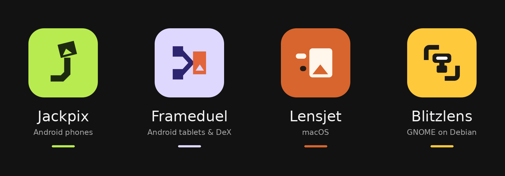
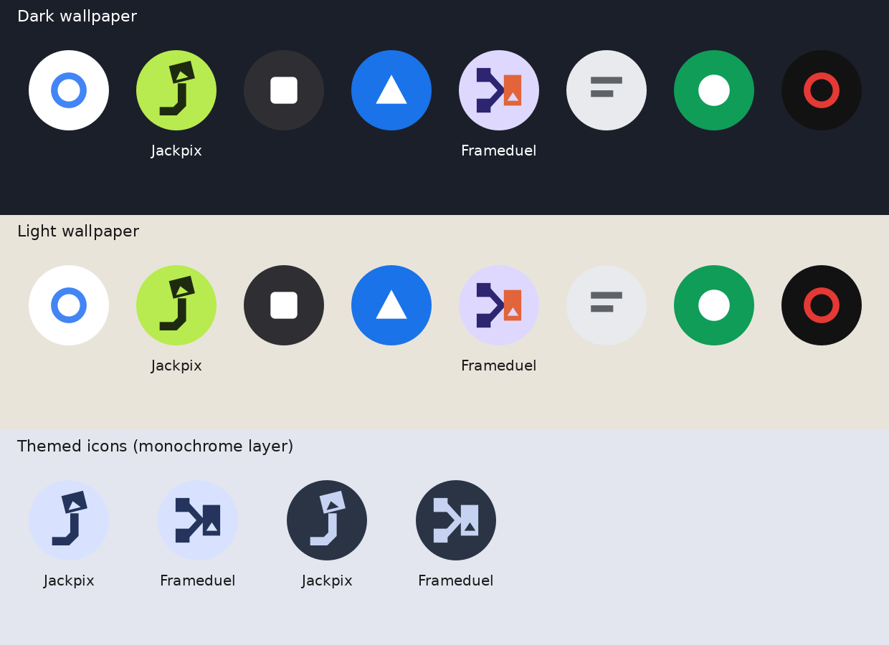
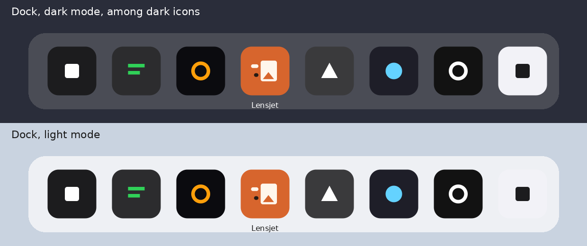
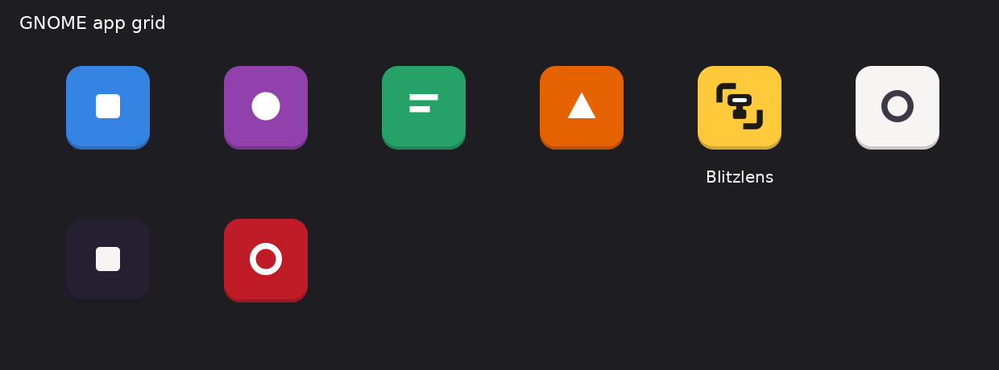
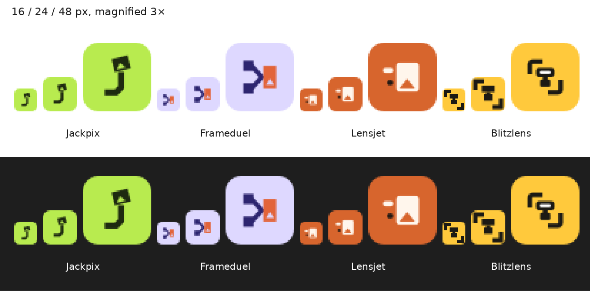
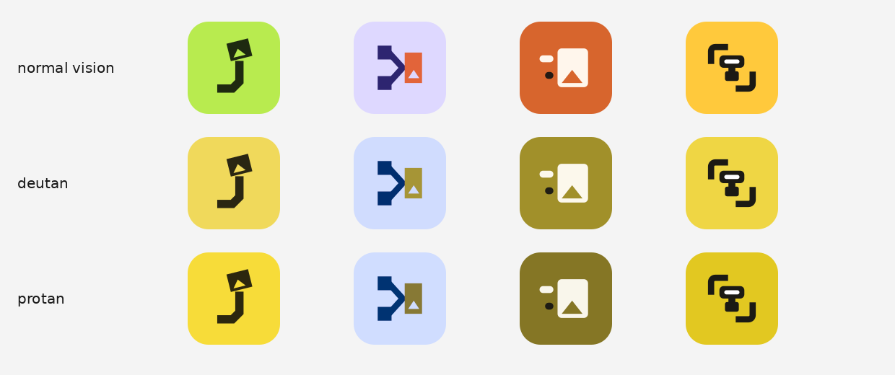
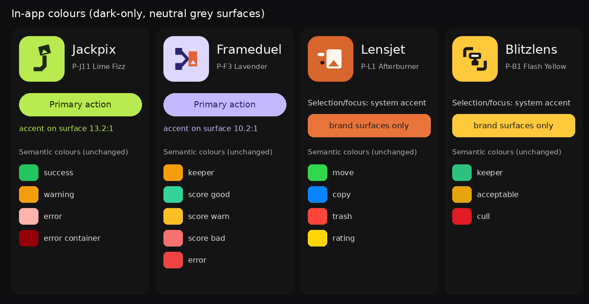

# Branding — names, icons and colours

The four active apps carry their own names, icons and colours. There is no family name
over them: where text has to name the set, it lists the four apps. The archived legacy
Desktop keeps its old name and icon.



## Names

| Product (code) | App name | Store / long title | Formerly |
|---|---|---|---|
| PhotoTok `products/android/phototok/` | **Jackpix** | Jackpix – Swipe & Tidy Photos | Photo-Tok |
| Android Desktop `products/android/android-desktop/` | **Frameduel** | Frameduel – Photo Culling Desk | PhotoSelector Studio |
| macOS Desktop `products/macos-desktop/` | **Lensjet** | Lensjet – Mac Photo Culling | PhotoSelector Studio |
| Linux Desktop `products/linux-desktop/` | **Blitzlens** | Blitzlens – Photo Culling | Photo Selector |
| Desktop (legacy, archived) `products/desktop/` | Photo Selector Toolbox (Legacy) | — | unchanged |

Rules for text:

- Write the app name in user-facing text, docs and release notes. "Android Desktop",
  "macOS Desktop" and "Linux Desktop" stay as platform descriptors next to the name
  ("Frameduel, the Android Desktop app"), never instead of it.
- German store titles are the English titles for now.
- No tagline or slogan, in the app or in its docs: Jackpix's landing shows the logo and the name
  only (maintainer decision 2026-10-21; the former "SWIPE. SELECT. SNAP." is retired).
- Each product's README and CHANGELOG say "formerly …" once. The old names stay in code
  identifiers and comments (internal codenames), in kept identifiers below, and in old
  CHANGELOG entries.
- Copyright: AlxPPa.

## Readable name ↔ identifier

Identifiers that stores, package managers or the system tie to user data are kept; the
mapping is the bridge. [`GLOSSARY.md`](../GLOSSARY.md) has the full table.

| App | Changed with the rename | Kept (and why) |
|---|---|---|
| Jackpix | app label, in-app texts, launcher icon | `applicationId` `com.phototok` (Play listing, Firebase, signing), Kotlin packages, `PHOTOTOK_*` CI variables, release asset names, release tags `phototok-v*`, the `PhotoTok_LeftSwipe` folder on the phone (user data) |
| Frameduel | app label, in-app texts, launcher icon | `applicationId` `com.photoselectortoolbox` (Play, Firebase, signing), packages, `TOOLBOX_*` CI variables, release asset names, tags `android-desktop-v*` |
| Lensjet | bundle id `app.alpatix.lensjet` (from `com.photoselectortoolbox.macos`, settings migrated once), bundle `Lensjet.app`, Dock name, icon | Swift targets `PhotoSelectorKit` / `PhotoSelectorApp`, Homebrew cask token, release zip name, tags `macos-desktop-v*` |
| Blitzlens | app id `app.alpatix.Blitzlens` (from `org.photoselector.Linux`, AppStream `<replaces>`), desktop entry, icons | Debian package `photo-selector-linux`, settings directory `~/.config/photo-selector-linux/`, APT Origin/Label and signing key, tags `linux-desktop-v*` |

The Selection marker file `.photoselector-selection` is shared by every product and stays.

## Icons

Masters live in [`assets/brand/glyphs/`](../../assets/brand/glyphs/) on a 48-unit grid;
[`assets/brand/palette.json`](../../assets/brand/palette.json) holds every colour. Every
exported size is generated — never edit an export by hand:

```bash
/usr/bin/python3 assets/brand/generate.py all       # Debian: system Python has PyGObject + Rsvg
python3 assets/brand/generate.py all                 # macOS: needs rsvg-convert (brew install librsvg)
python3 assets/brand/generate.py --check             # text exports current? (CI, stdlib only)
python3 assets/brand/generate.py --palette           # contrast and colour-vision table
```

| App | Concept | Glyph |
|---|---|---|
| Jackpix | J-03 "Sharp j" — a square-ended j whose dot is a tilted photo | [jackpix.svg](../../assets/brand/glyphs/jackpix.svg) |
| Frameduel | F-02 "Sharp Final" — two contenders, a chevron, the winning frame | [frameduel.svg](../../assets/brand/glyphs/frameduel.svg) |
| Lensjet | L-01 "Two-Dash Frame" — a photo frame with two speed dashes | [lensjet.svg](../../assets/brand/glyphs/lensjet.svg) |
| Blitzlens | B-10 "Framed Flash" — viewfinder corners around a flash unit | [blitzlens.svg](../../assets/brand/glyphs/blitzlens.svg), [16 px](../../assets/brand/glyphs/blitzlens-small.svg) |

What ties the set together: one grid, solid geometric marks, 4.5-unit linework with square
ends, and the photo "mountain" knocked out of the frame in three of the four glyphs.
Changes made to the concepts so they sit together:

- **B-10** moved from round open strokes to the set's 4.5-unit stroke with square ends; its
  viewfinder corners keep a radius of 3, the same as Lensjet's frame, and the small parts
  use 1.5. The idea (corners framing a flash) is unchanged.
- **B-10 at 16–24 px** gets its own pixel-aligned variant (corners and flash block, no window
  bar, which falls below one pixel). It is also the GNOME symbolic icon.
- J-03, F-02 and L-01 are unchanged.

Exports per platform:

| Platform | Files | Notes |
|---|---|---|
| Android (Jackpix, Frameduel) | `res/drawable/ic_launcher_{background,foreground,monochrome}.xml`, `ic_brand_mark.xml`, `res/mipmap-anydpi-v26/ic_launcher{,_round}.xml`, `res/mipmap-*/ic_launcher{,_round}.png`, `assets/brand/<app>/<app>-play-512.png` | Adaptive icon with the glyph in a 60 dp box inside the 66 dp safe zone (checked by a test); monochrome layer for themed icons with knockouts as holes; Play icon full-bleed, Play applies the mask |
| macOS (Lensjet) | `products/macos-desktop/Resources/AppIcon.icns` (16–1024 px incl. @2x) | Apple's grid: 824 pt body, 185.4 pt radius on a 1024 canvas. Built by `iconutil` on the Mac, by the built-in writer elsewhere. A dark-appearance master exists (`assets/brand/lensjet/lensjet-macos-dark.svg`); the Icon Composer format follows on the Mac |
| GNOME (Blitzlens) | `data/icons/hicolor/{scalable,16x16,24x24,128x128,symbolic}/apps/app.alpatix.Blitzlens*` | GNOME HIG body with a darker bottom edge; 16 and 24 px from the small variant |
| Docs, README | `assets/brand/<app>/<app>.svg`, `-512.png`, `-180.png` (touch icon), `-32.png` (favicon), `assets/banner.png` | |

Look-alike check (visual only, not a legal clearance): F-02 resembles merge/git-merge
symbols slightly; the others raised nothing.

## Colours

### Icon palettes

| App | Palette | Tile | Mark | Accent | Mark on tile |
|---|---|---|---|---|---|
| Jackpix | P-J11 Lime Fizz | `#B8EB4F` | `#1E2A10` | `#FF4F93` | 10.8:1 |
| Frameduel | P-F3 Lavender | `#DED8FF` | `#2D2570` | `#E2643A` | 9.6:1 |
| Lensjet | P-L1 Afterburner | `#D7652D` | `#FFF6EC` | `#241A14` | 3.4:1 |
| Blitzlens | P-B1 Flash Yellow | `#FFC93C` | `#1C1A14` | `#FFFFFF` | 11.3:1 |

Why these and not the board's first picks:

- The board's best fits for Jackpix, Frameduel and Lensjet were all a dark tile with an
  orange accent. Jackpix and Frameduel can sit on the same phone, and Lensjet sits in a Dock
  full of dark icons, so three dark-and-orange icons would only be told apart by shape.
  Each app now owns a hue: lime, lavender, orange, yellow.
- **Jackpix — Lime Fizz.** Bright and playful for a swipe app, no coral (P-J3's accent was
  coral, which was rejected before). Next to Frameduel on one home screen the two differ in
  hue for every vision type.
- **Frameduel — Lavender.** A light, calm desk colour that stays clear of every semantic
  colour in the app (amber keeper, green/amber/rose scores) — see the in-app section.
- **Lensjet — Afterburner.** The one warm, saturated tile in a Dock of dark and grey icons,
  and it fits the name. No blue: an earlier Lensjet read as a corporate blue.
- **Blitzlens — Flash Yellow.** Kept as chosen; it passes every check and stands out in the
  GNOME grid.
- With deuteranopia or protanopia, lime, orange and yellow all move towards yellow. Jackpix
  and Blitzlens then look alike in colour, but they never share a platform; on Android,
  Jackpix and Frameduel stay distinct (yellow vs. pale blue).







### In-app colours

All four apps stay **dark-only**. Judging a photo needs a dim, neutral surround: a light
interface around the image changes how bright and contrasty the photo looks, and every
comparable culling tool defaults to a dark grey surround. So large surfaces and the viewer
surround are **neutral grey** (equal red, green and blue — no tint that biases colour
judgement), and the brand colour is used sparingly.

| App | Selection, focus, primary action | Brand colour in the app | Semantic colours |
|---|---|---|---|
| Jackpix | Lime `#B8EB4F` on `#1E2A10` text (Material 3 `primary`) | primary action, selection, the in-app logo | unchanged: success `#22C55E`, warning `#F59E0B`, error roles |
| Frameduel | Lavender `#C4B8FF` on `#2D2570` text (Material 3 `primary`) | as Jackpix | unchanged: keeper `#F59E0B`, scores `#34D399` / `#FBBF24` / `#F87171`, error `#EF4444` |
| Lensjet | **the system accent** (`Color.accentColor`) | orange `#E8743A` on brand surfaces only (About, empty state) | unchanged: move green, copy blue, trash red, rating yellow |
| Blitzlens | **the system accent** (libadwaita `@accent_bg_color`, follows the GNOME accent setting) | yellow `#FFC93C` on brand surfaces only (About) | unchanged: keeper `#2EC27E`, acceptable `#E5A50A`, cull `#E01B24` |

Why the desktop apps do not paint selection in their brand colour: orange sits on the
red–green axis. Under deuteranopia Lensjet's oranges (`#D7652D`, `#E8743A`) and its red trash
state differ by ΔE 3.9 and 2.0 (the threshold here is 15), and no shade of orange fixes both red and green at once.
On macOS and GNOME the accent also belongs to the user (System Settings, GNOME Settings), so
following it is the platform idiom. The Android apps carry their own accent, which is the
Material 3 idiom when an app opts out of dynamic colour to keep its surfaces neutral.



Checks (`generate.py --palette`; WCAG 2.1 contrast; CIE76 ΔE after simulating
deuteranopia and protanopia with the Machado 2009 matrices, minimum 15):

| App | Pair | Result |
|---|---|---|
| Jackpix | accent `#B8EB4F` on surface `#141414` | 13.2:1 |
| Jackpix | text `#1E2A10` on accent | 10.8:1 |
| Jackpix | accent vs success `#22C55E` / warning `#F59E0B` / error `#FFB4AB` | ΔE deutan 33.3 / 16.0 / 45.5, protan 31.3 / 21.4 / 67.4 |
| Frameduel | accent `#C4B8FF` on surface `#141414` | 10.2:1 |
| Frameduel | text `#2D2570` on accent | 7.2:1 |
| Frameduel | accent vs keeper / score good / score bad / error | ΔE deutan 107.7 / 46.7 / 64.9 / 80.6, protan 104.4 / 57.7 / 52.8 / 67.0 |
| Lensjet | brand `#E8743A` on surface `#141414` | 6.1:1 |
| Lensjet | orange `#E8743A` vs trash red `#FF453A` (why selection follows the system accent) | ΔE deutan 2.0 — fails, so orange is never a state colour |
| Blitzlens | brand `#FFC93C` on surface `#141414` | 12.0:1 |

`scripts/tests/test_brand_assets.py` keeps these thresholds, the exports and the Android safe
zone honest.
